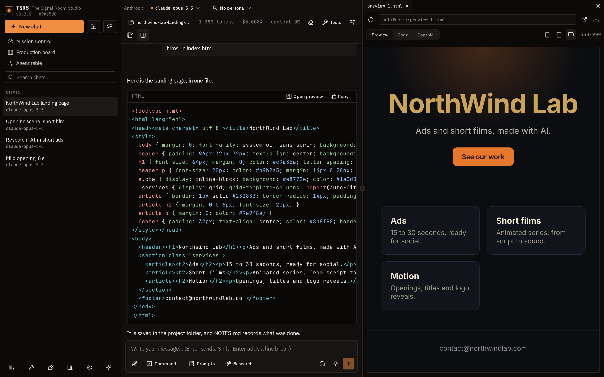
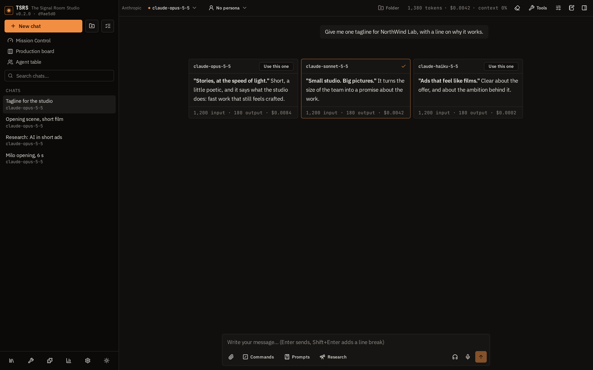
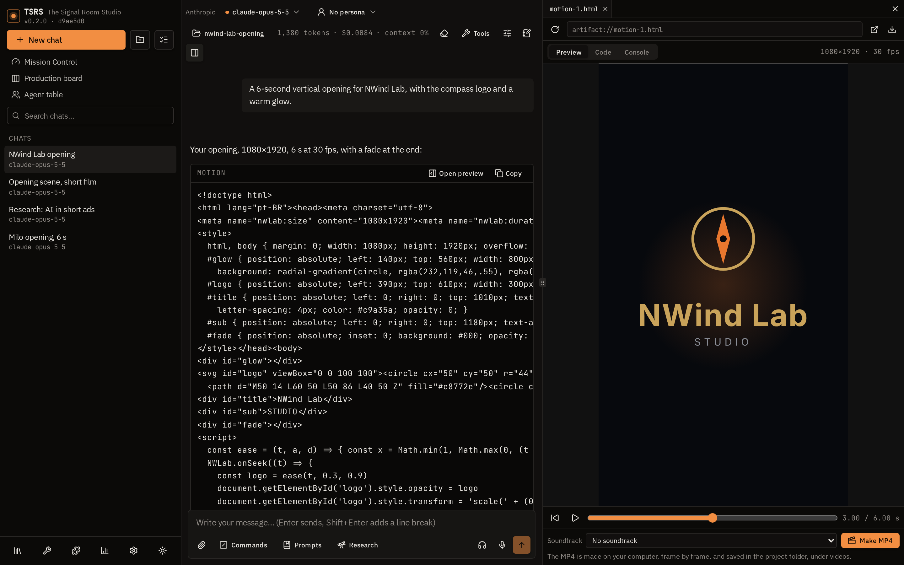
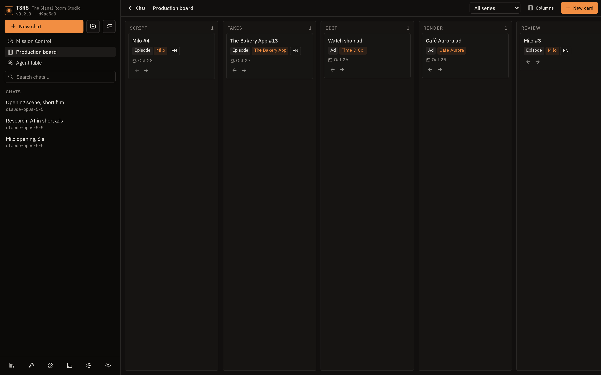
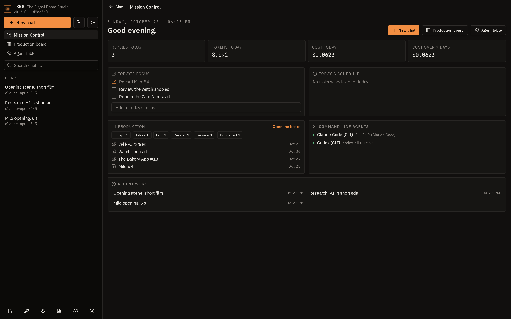

# TSRS — The Signal Room Studio

**English** · [Português](README.pt-BR.md)

A local-first studio for working with AI models. Bring your own API keys, use
every major model from one screen, and keep your conversations, keys and files on
your own computer.

TSRS is open source (MIT) and made by [NorthWind Lab](https://northwindlab.com).
There is no TSRS account, no subscription, no telemetry and no TSRS cloud: the
app runs in your browser and talks straight to the provider you chose. The
optional local server (`npm run dev`) runs on your own machine and adds the
things a browser cannot do alone, such as saving files to folders, rendering
video and running scheduled tasks.

> **New here?** The user manual, in Portuguese for now, walks through every
> feature with tips: [docs/MANUAL.pt-BR.md](docs/MANUAL.pt-BR.md). There is also a
> video tutorial in 14 short lessons:
> [TSRS in 14 lessons](https://sleek-reef-by4y.here.now/) (in Portuguese:
> [TSRS em 14 aulas](https://radiant-tulip-gc8d.here.now/)).



## Why TSRS

- **Every model, one place.** Anthropic, OpenAI, Gemini, OpenRouter, DeepSeek,
  Elorian, Mistral, xAI, Groq, Perplexity, local models through Ollama or LM Studio, and
  any OpenAI-compatible endpoint. Compare up to four answers side by side.
- **Pay only for what you use.** Your keys, the providers' prices, no markup.
  TSRS shows the tokens and the estimated cost of every reply and of each day.
- **Your data stays yours.** Conversations live in your browser; keys can be
  encrypted with a password; nothing is sent anywhere else. Sync between devices
  goes through a folder, WebDAV server or S3 bucket of your own.
- **Real files, not just chat.** Pages, code, documents, generated media and
  rendered videos are saved in a project folder per conversation, so Claude Code,
  Codex or any editor can carry on from the same files.
- **Extensible in the formats you already know.** Skills and plugins use the same
  layout as Claude's, plus MCP servers and your own tools by HTTP or JavaScript.
- **More than text.** Images, video, voice, music, motion graphics rendered to
  MP4, deep research reports, a canvas, a live preview for pages and apps.

## Screenshots

<table>
<tr>
<td width="50%"><a href="docs/screenshots/compare.png"></a><br><sub>Compare three models side by side</sub></td>
<td width="50%"><a href="docs/screenshots/motion.png"></a><br><sub>A motion composition with its timeline, ready to render to MP4</sub></td>
</tr>
<tr>
<td width="50%"><a href="docs/screenshots/production-board.png"></a><br><sub>The production board: every episode and ad, column by column</sub></td>
<td width="50%"><a href="docs/screenshots/mission-control.png"></a><br><sub>Mission Control: focus, usage, production and agents at a glance</sub></td>
</tr>
</table>

## Quick start

You need [Node.js](https://nodejs.org) 22 or newer and a Chromium-based browser
(Chrome, Edge, Brave, Arc) or Firefox/Safari.

```bash
git clone https://github.com/Eddienews/tsrs.git
cd tsrs
npm ci
npm run dev        # http://localhost:5173
```

Open **Settings**, paste the API key of a provider, click **Load models** (or
type a model name in the top bar) and send a message. After that the list
updates itself once a day, and new models (fine-tuned ones included) are marked
as new in the model picker. With
[Ollama](https://ollama.com) installed, local models work with no key at all.

Optional extras:

```bash
npm run proxy                         # local proxy for APIs that refuse browsers (OpenCode, Replicate…)
npm run render -- motion-1.html       # render a motion composition to MP4 (needs ffmpeg)
npm run render:serve                  # standalone renderer, for a TSRS not served by npm run dev
npm run build                         # type check + production build in dist/
```

Rendering video needs [ffmpeg](https://ffmpeg.org) (Windows:
`winget install Gyan.FFmpeg`; macOS: `brew install ffmpeg`; Linux: your package
manager) and Chrome, Edge or Playwright's Chromium.

## Features

### Conversations
- Streaming replies with Markdown, code highlighting and copy buttons; edit,
  regenerate, retry, and keep every version (‹ › arrows on each message).
- Branch a conversation from any message; pin messages; search, folders, tags,
  archive and bulk actions; automatic titles.
- Compare models: up to three other models answer the same question in columns.
- Side question: select part of a reply and ask about it in a side panel.
- Temporary conversations that leave no history.
- Per-conversation system prompt, temperature, max tokens and reasoning effort;
  the model's reasoning, folded above the reply, when the provider sends it.
- Continue a long conversation in a new one: the model writes a handoff (the
  goal, the decisions, the files, the next step) and the new chat starts from it,
  with the same model, settings and project folder. Or summarize the context in
  place, or clear it from any point (undoable) so earlier messages stop being sent.
- Command palette (Ctrl/⌘+K), configurable shortcuts, timestamps, a sound when a
  reply ends, light and dark themes, accent colour, font size and density.
- Interface in English and Portuguese.

### Files and knowledge
- Attach images, PDFs, text files, Word and PowerPoint files (read as Markdown,
  slide by slide with the notes), Excel spreadsheets (read as CSV, one per
  sheet), audio (transcribed by OpenAI, Groq or local Whisper so any model can
  use it) and video: up to 16 frames spread over it go as images, with the
  transcription of what is said, so any model with vision can talk about it.
- Local knowledge bases: PDFs, text, Markdown and HTML split into passages and
  searched by words (BM25, no API) and optionally by meaning (embeddings), per
  conversation or per agent; the model can search again with `knowledge_search`.
- **Project folder**: the files a conversation makes are saved in
  `projetos/<conversation>/` with a `NOTAS.md`; the model reads the current
  version before changing anything, so you can switch between TSRS and other
  tools. Any other folder can be used instead. The model can also write **Word
  (.docx) and PowerPoint (.pptx)** files there, and read them back.
- **Folder context**: instructions, files and an agent for every conversation in
  a sidebar folder.

### Preview, canvas and video
- Live preview of HTML, SVG, JavaScript, Markdown, React (JSX/TSX) and Mermaid,
  isolated from the app, with code and console tabs and screen sizes; the address
  bar also opens pages such as `localhost:3000`.
- Canvas: a document or code beside the chat that the model writes and edits with
  tools and you edit by hand.
- **Motion video**: a `motion` block is an animated HTML page (CSS, anime.js,
  Lottie or your own drawing per frame) with a timeline in the preview; **Make
  MP4** renders it frame by frame with a soundtrack. See [Motion video](#motion-video).
- **Short videos** (Reels, TikTok, Shorts): ask for a topic and TSRS narrates the
  scenes with word timings, finds free stock clips (Pexels, Pixabay) for each,
  cuts them to the voice, adds word-by-word captions, title, end card and music
  under the voice, and saves the MP4 with a `CREDITOS.md` in the project folder.
- **Design tools** for the pages a conversation makes: the model finds real,
  openly licensed pictures of the subject (Openverse, Wikimedia Commons, the Art
  Institute of Chicago, the Met; no key), saves them in `imagens/` with their
  credits in `CREDITOS.md`, and **looks at its page**: rendered in your Chrome or
  Edge at desktop, tablet and phone widths, measured (overflow, broken images,
  contrast, cut-off or covered text) and photographed, so it can fix what it
  sees. With the **taste-skill** example skill on (by
  [Leonxlnx](https://github.com/Leonxlnx/taste-skill), MIT), it also draws an
  art direction from a library studied from 247 sites and checks the page
  against its house style. Needs Node 22.
- **Open APIs** for live data in pages, dashboards and apps: a catalogue of 38
  free APIs, picked from [public-apis](https://github.com/public-apis/public-apis)
  and checked to answer without a key, over HTTPS and from the browser (weather,
  exchange rates, countries and Brazilian data, holidays, museum art, icons,
  science, books, radio, statistics). Each entry says what its terms allow
  (any use, with a credit, non-commercial only, per item, or still to check), so
  the model credits the source and warns before commercial use. For a motion
  video the data is fetched once and saved in `midia/` with its credit in
  `CREDITOS.md`, so every render of the MP4 is the same. The catalogue is
  `src/openApis.ts`.
- **React components** for projects built with React or Next.js: the model
  searches [cult/ui](https://github.com/nolly-studio/cult-ui) (about 150
  components, MIT) and copies the one it needs into `components/ui/`, with the
  shadcn components it builds on, the npm packages to install and the credit in
  `CREDITOS.md`; files already in the project are kept. A `DESIGN.md` in the
  project folder goes with every request and wins over any skill's defaults.

### Media and voice
- Images, video, speech, music and sound effects with the providers' keys
  (OpenAI, Gemini, xAI) or media services' (ElevenLabs, Runware, fal.ai,
  Replicate, WaveSpeedAI, Higgsfield, Stability AI, Black Forest Labs, MiniMax,
  Cartesia), with the estimated cost before sending when the service publishes it.
- Read replies aloud with the browser's most natural voice (Microsoft Edge's
  free neural voices) or an ElevenLabs, OpenAI or Gemini voice; pick your own
  ElevenLabs voices with samples and prices, or make a new one from the app:
  designed from a description (three versions to choose from) or cloned from
  recordings, with the speaker's consent.
- Free local voices with no key and no internet after the first download:
  Piper reads replies aloud (and narrates short videos), and Whisper transcribes
  dictation and attached audio, both running in the browser. The TSRS server
  downloads each model once into `modelos/` and serves it from there.
- Dictation through OpenAI, Groq, local Whisper or the browser's speech
  recognition.

### Tools, agents and extensions
- JavaScript interpreter (optional, in Tools): the model runs code for exact
  math, analysis of the attached CSVs and spreadsheets, and charts that show in
  the reply. The code runs in a worker inside a sandboxed frame, with no network
  and no access to the app or its keys.
- Remote MCP servers, with permission before each call.
- Web search and page reading by the provider (Anthropic, OpenRouter) or with
  **your own key** (Brave, Tavily, Google, Kagi) for any model, with sources.
- **Deep research**: rounds of searching and reading that end in a report with
  cited sources, saved in the project folder.
- Agents: personas with a model, parameters (temperature, max tokens,
  reasoning), tools, skills and plugins, files, knowledge and starter prompts;
  call one for a single message with **@name**. Four come with the app, along
  with ready-made prompts with `{{fields}}`, and a community gallery adds more
  than 50 others, by category.
- Example skills and plugins that install with one click (Extensions →
  Examples), including free no-key tools: exchange rates, holidays, weather and
  Wikipedia.
- **Prompt chains**: saved prompts with steps, each sent when the previous
  reply is done, with `{{resposta}}` for that reply.
- Memory (optional): facts the model keeps about you, in a list you can edit.
- **Skills** in Claude's `SKILL.md` format, loaded only when a task needs them.
- **Plugins** in Claude's layout (skills, commands, agents, MCP servers) plus
  your own tools by HTTP or sandboxed JavaScript.
- **Schedule**: prompts the local server sends to a model on time, even with
  the tab closed, optionally with your own web search, skills and plugins'
  HTTP tools; the answers land in a conversation.

### Studio
- **Coding agents on your computer**: Claude Code and Codex answer in a
  conversation like any other model, through their own command line, login and
  plan. They work in the conversation's project folder with their own tools
  (their commands and file edits show in the reply), and later messages carry
  on the same session. Settings choose the command and what the agent may do
  there: only read, edit files, or full access.
- **Mission Control** (Painel do dia): today's replies, tokens and cost, a list
  of what to get done today, the schedule's runs, the production board by stage
  with what is due this week, the coding agents and how much of their plan's
  limit is used, and the recent work. TSRS can open on it.
- **Production board**: a card per episode, ad or video, moved through the
  stages of making it (script, takes, edit, render, review, published, or your
  own columns). Cards link to a conversation, show their due date and count the
  takes in their project folder (`takes/*.json`). Kept in
  `projetos/_producao/quadro.json`, with the previous version beside it.
- **Agent table**: agents from the library work on one task together, each in
  its role, in up to three rounds where everyone reads what the others wrote;
  a coordinator writes the result. Each agent uses its own model, coding agents
  included. The run is kept as `mesa.md` in its folder and can become a
  conversation.
- **Voice conversation**: hands-free; speak, and at a pause it is sent, the
  reply is read aloud and the microphone opens again.
- **Obsidian**: conversations kept as notes in your vault, with the model,
  dates and tags as properties, saved by hand or after every reply.
- Sidebar sections you don't use can be hidden.

### Costs, privacy and sync
- Tokens and estimated cost per reply, per conversation and per day and model
  (usage view); prompt caching on Anthropic; a price you type for models the app
  does not know.
- API keys optionally encrypted with a password (PBKDF2 + AES-GCM).
- Sync between devices through a folder kept in sync by Dropbox, Drive, OneDrive
  or Syncthing, a WebDAV server or an S3 bucket, optionally encrypted; keys are
  never synced.
- Backup and restore everything as JSON; export a conversation as Markdown or a
  single HTML page; installable as an app (PWA).
- Profiles (personal, work…): each with its own keys, conversations, library,
  password, sync and backup, switched from the sidebar.
- Automatic backup on disk: a few seconds after every change, conversations,
  library and settings are copied to `backups/` in the TSRS folder (one copy per
  day for 14 days). If the browser wipes its data, TSRS offers to bring it all
  back; API keys go in only encrypted with your password.
- The running version and git commit are shown under the name, so a screenshot
  says which code was running.

## Local server features

`npm run dev` serves the app and, on the same address, a few local services that
only accept requests from TSRS itself:

| Path | What it does | Folder |
| --- | --- | --- |
| `/__tsrs/projects` | Project folders: save, list, read and serve the files of a conversation | `projetos/` (`TSRS_PROJECTS`) |
| `/__tsrs/render` | Renders motion compositions to MP4 | `renders/` or the project's `videos/` (`TSRS_RENDERS`) |
| `/__tsrs/ext` | Skills, plugins, own tools by HTTP, web search and page reading, schedule | `extensoes/` (`TSRS_EXTENSIONS`) |
| `/__tsrs/cli` | Starts Claude Code or Codex in a conversation's folder and relays what they print | the conversation's project folder |
| `/__tsrs/board` | The production board, and the takes counted in a project folder | `projetos/_producao/` |
| `/__tsrs/agent` | The `tsrs` command, for agents: needs the token in `extensoes/.tsrs-agent.json` and refuses web pages | — |

Nothing is ever deleted for real: removed skills and plugins go to
`extensoes/_removidas/`, and a video never overwrites another. A static build
(`npm run build`) still works as a browser-only app without these features.

## Agents: the tsrs command

Claude Code, Codex or a bot can use the TSRS that is running, from a terminal:

```bash
npm link                     # once, in the TSRS folder: puts `tsrs` on the PATH
tsrs status
tsrs projects new "Cafe Aurora ad"
tsrs projects write cafe-aurora-ad ad.html --from ./ad.html
tsrs render motion cafe-aurora-ad ad.html --audio midia/track.mp3
tsrs board move "Cafe Aurora ad" render
tsrs agenda run "AI news digest"        # exit 3: it calls a paid model; add --yes once agreed
```

| Kind | Commands | Without `--yes` |
| --- | --- | --- |
| read | `status`, `projects list/files/read`, `design check`, `board list`, `agenda list` | — |
| write | `projects new/write`, `render motion`, `board add/move/update/remove`, `image local` | replacing a file only says what it would do |
| cost | `agenda run` | only says which paid model it would call |

`tsrs --help` lists them all and `tsrs <command> --help` gives the arguments.
Add `--json` for a stable answer (`{ ok, text, result }` or `{ ok: false, code, error }`).
Exit codes: `0` done, `2` wrong arguments, `3` needs `--yes`, `4` TSRS is not
running, `5` failed. `tsrs mcp` offers the same commands as an MCP server on
stdio, for example `claude mcp add tsrs -- tsrs mcp`; tools that ask for `--yes`
take `yes: true`. `skills/tsrs/SKILL.md` teaches an agent the rules (copy it to
`~/.claude/skills/tsrs/` or your agent's skills folder).

Each start of `npm run dev` writes a fresh token to `extensoes/.tsrs-agent.json`,
readable by your user only; the command sends it, and requests from web pages
are refused. Chats, the library, memory, the agent table and paid media stay in
the browser and are not in the command yet.

## Motion video

Ask for an animation ("a 6-second opening in 1080x1920 with the title X"). The
reply comes as a `motion` block that opens in the preview with a timeline; the
soundtrack plays with it. **Make MP4** renders the video on your computer and
saves it in the project folder.

A composition is an ordinary HTML page. Size, duration and frame rate come from
`<meta name="nwlab:size" content="1080x1920">`,
`<meta name="nwlab:duration" content="8">` and
`<meta name="nwlab:fps" content="30">`; `<meta name="nwlab:audio" content="midia/song.mp3">`
picks the soundtrack among the audio files of the project folder (otherwise the
audio file the code names, else the newest one). A composition saved in the
project folder (by the model's project tools) opens in the preview as that file
and follows it as it is edited, so **Make MP4** always renders the file on disk.
The runtime (`public/motion/runtime.js`)
loads before the page's own scripts and moves it to each time `t`:

- CSS animations, transitions and Web Animations are paused and set to `t`;
- anime.js v4 timelines (global `anime`, created with `autoplay: false`) passed
  to `NWLab.register(tl)` are set to `t`;
- functions passed to `NWLab.onSeek((t) => …)` or `window.nwlabSeek(t)` draw the frame;
- Lottie (global `lottie`, `svg` renderer, `autoplay: false`) with `goToAndStop` in `onSeek`.

Nothing may depend on the clock (`Date`, `requestAnimationFrame`, `setTimeout`)
or on unseeded `Math.random`: the same `t` must give the same frame, so the
video comes out the same on any machine. From the terminal:

```bash
npm run render -- motion-1.html                      # writes motion-1.mp4 beside it
npm run render -- motion-1.html --audio track.wav    # with a soundtrack, trimmed and faded
npm run render -- motion-1.html --fps 60 --crf 16 --out opening.mp4
```

This is the same contract as NWLab ForgeOS motion pages.

## Providers

Anthropic, OpenAI, Google Gemini, OpenRouter, DeepSeek, Elorian, Mistral, xAI (Grok),
Groq, Perplexity, Command Code, OpenCode Zen and Go (through the local proxy),
Azure OpenAI (your resource's v1 endpoint, with deployments typed by name),
Ollama and LM Studio (local), and any endpoint compatible with OpenAI's chat API
("Custom").

Claude Code and Codex, installed on the same computer, are providers too
(`format: 'cli'`): the base URL is the command, the server starts it in the
conversation's project folder (`server/cli.mjs`) and the app reads its events
(`src/cliAgents.ts`). They use their own login and plan, so TSRS shows their
tokens but no price.

Each provider is one row in `src/providers.ts`: base URL, paths, headers (with
`{apiKey}` as a placeholder) and the API format (`openai` or `anthropic`). An
OpenAI-compatible provider needs no new code.

APIs that refuse calls from browsers work through `npm run proxy`, which listens
only on `localhost:8787`, answers only the app's origin and forwards only to the
hosts it allows (`--allow host` adds more).

## Project layout

| Path | Role |
| --- | --- |
| `src/App.tsx` | Conversation state, generating replies, layout |
| `src/stream.ts` | Streaming client (fetch + SSE), errors, model lists, tool loop |
| `src/providers.ts` | Provider table and known prices |
| `src/storage.ts` | Settings in localStorage, conversations in IndexedDB |
| `src/preview.ts`, `src/PreviewPanel.tsx`, `src/MotionStage.tsx` | Preview and motion timeline |
| `src/projects.ts`, `server/projects.mjs` | Project folders |
| `src/extensions.ts`, `server/extensions.mjs` | Skills, plugins and own tools |
| `src/agenda.ts`, `server/agenda.mjs` | Schedule |
| `src/cliAgents.ts`, `server/cli.mjs` | Claude Code and Codex as providers |
| `src/board.ts`, `src/BoardView.tsx`, `server/board.mjs` | Production board |
| `src/agentTable.ts`, `src/TableView.tsx` | Agent table |
| `src/mission.ts`, `src/MissionView.tsx` | Mission Control |
| `src/voiceLoop.ts`, `src/obsidian.ts` | Voice conversation, Obsidian notes |
| `src/webSearch.ts`, `src/research.ts`, `server/search.mjs` | Own web search and deep research |
| `render/` | Motion contract, MP4 renderer and its Vite plugin |
| `bin/tsrs.mjs`, `server/agent*.mjs`, `skills/tsrs/` | The `tsrs` command, its MCP server and the agent skill |
| `src/media.ts`, `src/mediaJobs.ts`, `src/mediaPrice.ts` | Media services, jobs and prices |
| `src/knowledge.ts`, `src/embeddings.ts`, `src/extract.ts` | Knowledge bases |
| `src/sync*.ts` | Sync through a folder, WebDAV or S3 |
| `src/i18n.ts`, `src/locales/en.ts` | Interface language; English texts keyed by the Portuguese ones |
| `proxy/cors-proxy.mjs` | Local CORS proxy |
| `e2e/` | End-to-end tests and the fake provider they use |

Conversations are stored in IndexedDB in two parts: metadata (title, folder,
model, canvas) and messages, read when the conversation opens.

## Known limitations

- Without a password, API keys are stored in `localStorage` as plain text. With
  one, they are encrypted at rest but stay in the page's memory while unlocked.
- Costs are estimates: the provider's figure when it sends one, otherwise a price
  table that may be out of date, or a price you typed.
- Folder sync needs a browser that writes to folders (Chromium-based); Firefox
  and Safari can use WebDAV or S3.
- MCP: remote HTTP servers that accept browser calls (CORS), with an optional
  token. Local command-line servers, OAuth login, MCP resources and prompts are
  not supported.
- The preview runs generated code isolated from the app but with network
  access; React and Mermaid load libraries from public CDNs.
- Project folders, video rendering, skills, plugins, own search, the schedule,
  the coding agents, the production board and Obsidian notes need the local
  server (`npm run dev`); the schedule needs the computer on.
- A coding agent with full access runs any command on your computer without
  asking. Keep it to folders and projects you trust.
- Tool results are third-party text sent to the model; keep permission requests
  on for servers you do not trust, and install plugins only from people you trust.

## Contributing

Contributions are welcome: read [CONTRIBUTING.md](CONTRIBUTING.md) for the
principles, how to run the tests and how to send a pull request, and the
[Code of Conduct](CODE_OF_CONDUCT.md). Ideas and questions go to
[Discussions](../../discussions); bugs and feature requests to
[Issues](../../issues). Security problems: see [SECURITY.md](SECURITY.md).

What is done and what comes next: [ROADMAP.md](ROADMAP.md).

## License

[MIT](LICENSE). anime.js and lottie-web, bundled in `public/motion/`, are MIT too.
The local voices use Transformers.js and ONNX Runtime Web (Apache-2.0/MIT) and
piper_phonemize, built on espeak-ng (GPL-3.0), loaded only when a Piper voice is
used; Piper's voices and the Whisper models have licenses of their own, listed
on their Hugging Face pages.
